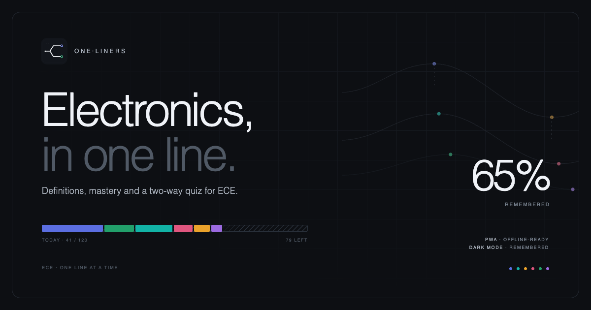
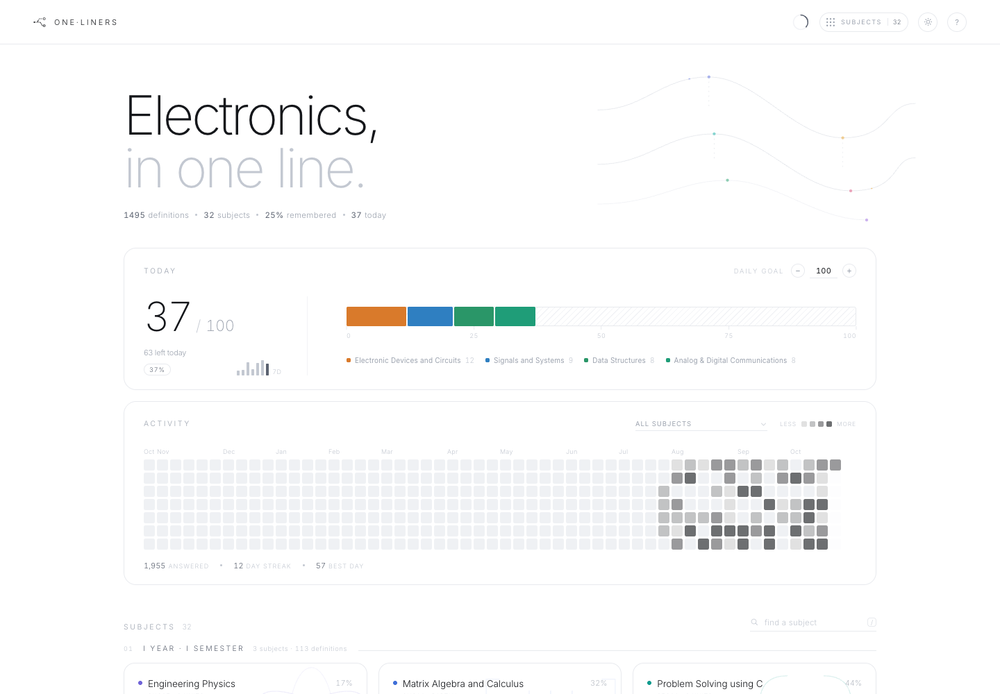
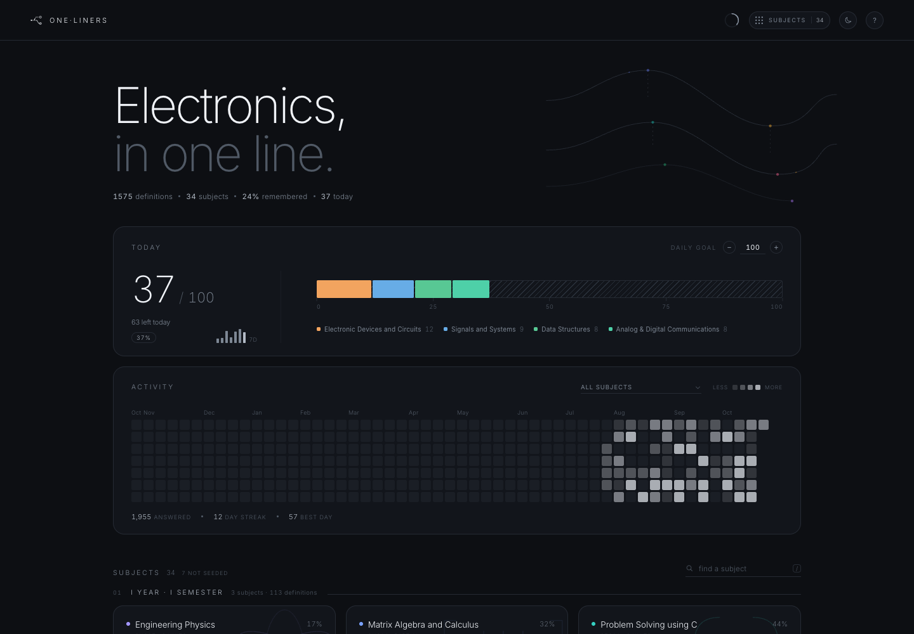
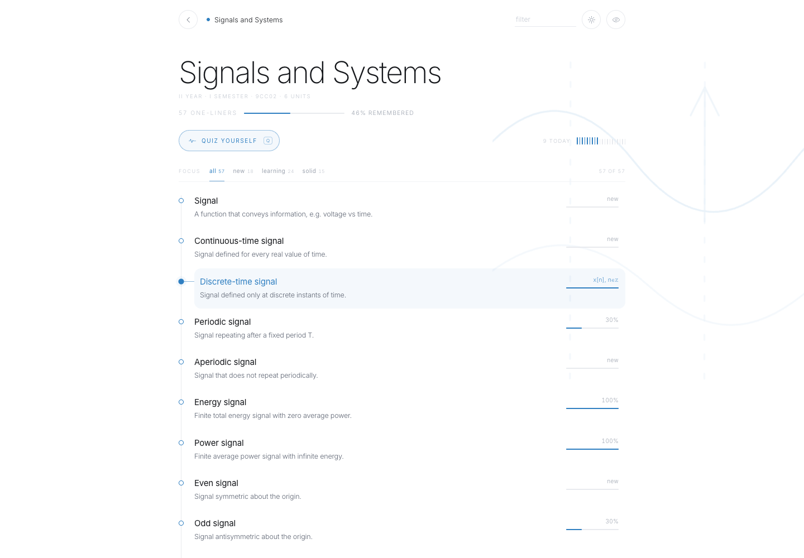
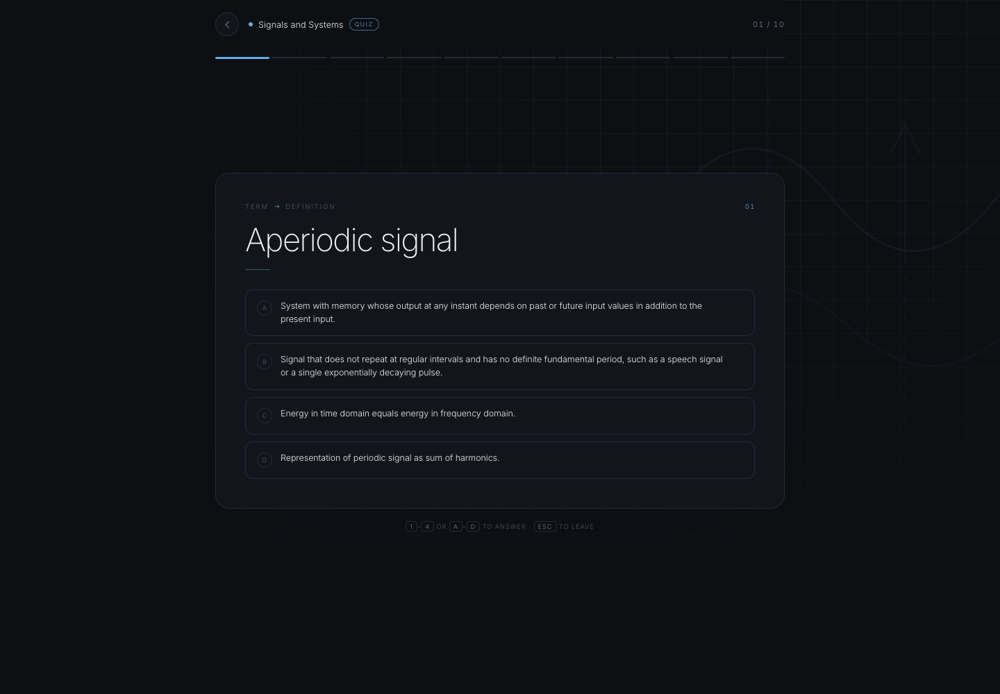
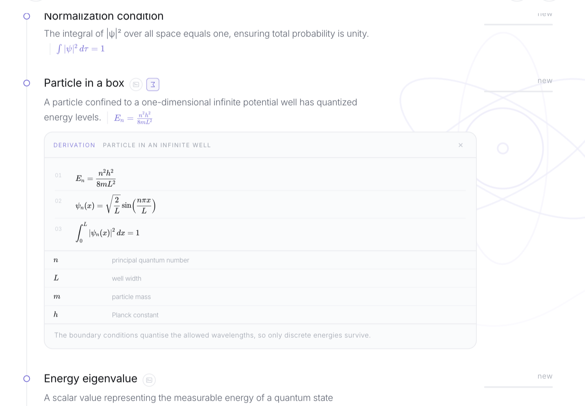
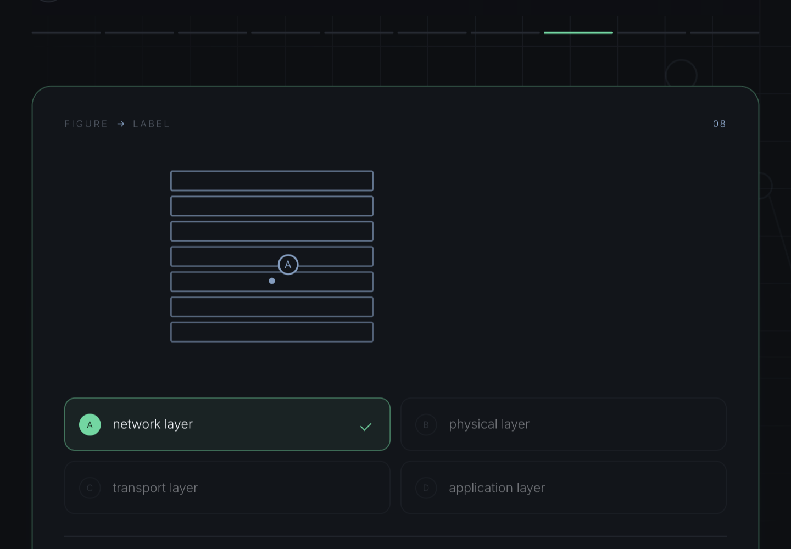
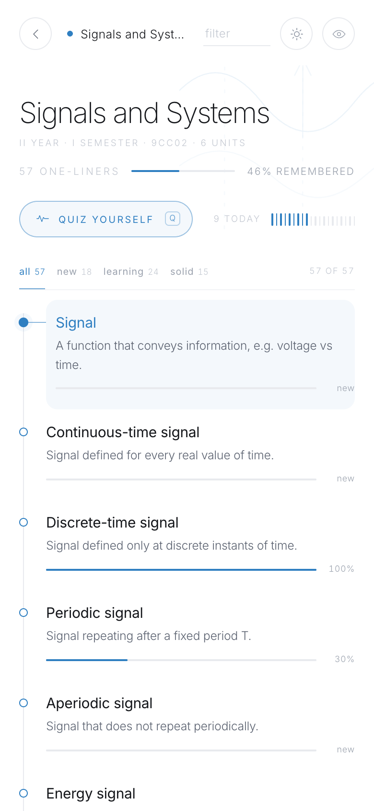
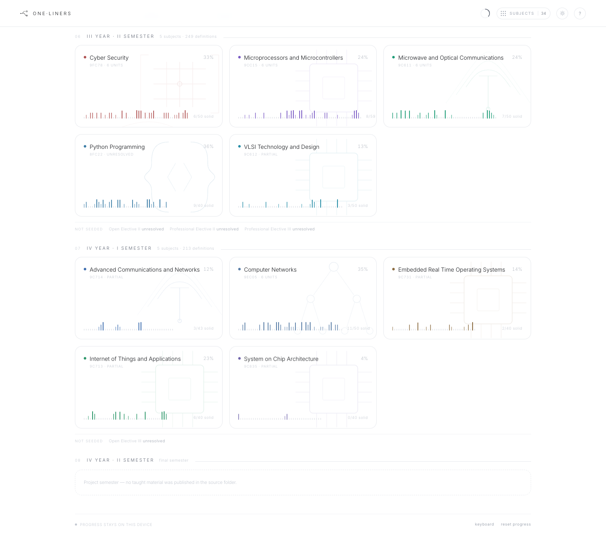

<div align="center">
  
</div>

<div align="center">

# one·liners

**Electronics, in one line.**

A quiet ECE study instrument: 2,773 definitions across 51 subjects — every A22 core course
and elective option, every unit — grouped by semester, with 1,662 typeset equations, 624
concept diagrams, 431 cold surfaces (code, spec tables, sequences, derivations), a daily
practice stack, adaptive quizzes in four directions, source traceability, and a memory of
what you actually know.

<a href="https://abhinav-prabhakar.github.io/ECEDefinitions/">
  
</a>

<br /><br />


</div>

<p align="center"><sub>Screenshots use sample study data. The app itself starts clean, on your device.</sub></p>

---

## Why this exists

ECE is full of definitions that are one sentence long and three lectures deep. Most study
apps bury them under dashboards. **one·liners** does the opposite: one line per definition,
one deliberate action per day, and a memory layer that stays out of the way until you need it.

White paper, hairline rules, thin type. Subject colour appears only where it carries meaning.
No accounts, no server, no noise.

> **Recognition is not recall.** So the quiz asks in both directions.

---

## Equations, not walls of text

Every definition that has an honest relation carries one, set in bare LaTeX and rendered by
a self-hosted KaTeX build: `λ = h/p`, `E_n = n²h²/8mL²`, `H(z) = Y(z)/X(z)`,
`T(n) = 2T(n/2) + Θ(n)`. 1,662 definitions do. The rest are genuinely descriptive, and
stay that way — an invented equation is worse than no equation.

- Equations are **inline on the subject page**, not hidden behind a hover.
- They inherit the subject colour and the active theme; no math-font flash, no third-party
  request, and no network after the first visit.
- `node scripts/check-formulas.mjs` parses every stored formula against the same KaTeX
  build before it ships.

## Figures where a figure earns it

624 definitions carry a thin-line concept diagram: 57% of Engineering Physics, 30–42% of
the core electronics, signals and communications subjects, 15–25% of the systems subjects,
and only a handful in programming, management and values. The density is deliberate.

- **Subject page:** a small frame glyph after the term; hover or focus reveals the drawing.
  Nothing moves, nothing shifts, and the page stays a page.
- **Quiz:** once you answer, the equation and the figure are shown directly with the
  explanation — no hunting.
- One shared SVG sprite, 198 symbols, drawn in `currentColor` + the subject accent. It
  works in both themes and offline like the rest of the shell.
- The library is generated from `scripts/diagrams/*.py`; every drawing is on the same
  240×150 grid, 1px line, sparse uppercase labels.

## Cold surfaces, when a sentence cannot carry it

Some things are not definitions. A pointer is understood by seeing `*p`; a register is
understood by its bitfield; a handshake is understood by its order; an eigenvalue is
understood by the three lines between the equation and the result. 431 definitions carry
one of four small, read-only surfaces:

| Surface | What it shows | Examples |
| --- | --- | --- |
| **code** | 3–16 numbered lines, one highlighted, optional deterministic output | pointer arithmetic, a Python decorator, a SystemVerilog constraint, an ARM exception vector |
| **spec** | a hairline table with one highlighted row | BJT operating regions, OSI layers, cache address fields, financial ratios |
| **sequence** | 2–4 actors, 3–8 ordered steps, stepped one at a time | TCP open, context switch, DMA transfer, three-way handshake |
| **derivation** | 2–7 KaTeX steps plus a symbol table | particle in a box, Friis, backpropagation, Elmore delay |

- **Click, not hover.** The second glyph after the term opens the surface inline under the
  definition; one is open at a time, and the panel closes cleanly. Diagrams stay hover
  because they are glimpsed; surfaces are clicked because they are read.
- **Rare by design.** 15.5% of definitions, concentrated where the syntax or the algebra is
  the point, and nearly absent from pure prose: 14 in Python, 12 in C, 2 in UHV. No
  definition carries a surface merely to have one.
- **The same surface in the quiz.** Answer a question on a definition that owns one and the
  table, code or derivation appears with the explanation — including a steppable sequence.
- Every artifact is data (`data/artifacts/parts/*.json`), built and validated like the
  rest: `scripts/build-artifacts.py`, `scripts/validate-artifacts.py`, and the shared KaTeX
  checker.

## Screenshots

<table>
  <tr>
    <td width="50%">
      
      <p align="center"><sub><strong>Light by default</strong> · today, activity, subject mastery</sub></p>
    </td>
    <td width="50%">
      
      <p align="center"><sub><strong>Dark when you choose it</strong> · remembered across visits</sub></p>
    </td>
  </tr>
</table>

<table>
  <tr>
    <td width="58%">
      
      <p align="center"><sub><strong>Every definition has a memory.</strong> Hover a row for its mastery; hover again for its formula.</sub></p>
    </td>
    <td width="42%">
      
      <p align="center"><sub><strong>Answers explain themselves.</strong> The cue, the definition, and what you picked.</sub></p>
    </td>
  </tr>
</table>

<table>
  <tr>
    <td width="58%">
      
      <p align="center"><sub><strong>The algebra between the formula and the answer.</strong> A derivation surface: numbered steps, a symbol table, one line of why.</sub></p>
    </td>
    <td width="42%">
      
      <p align="center"><sub><strong>Name the marked part.</strong> The drawing loses its lettering while you answer; the reveal puts it back.</sub></p>
    </td>
  </tr>
</table>

<div align="center">
  
  <p><sub><strong>320 → 1440px.</strong> The same quiet interface, not a crushed desktop.</sub></p>
</div>

---

## The curriculum, by semester

The home page is the A22 map, not a flat list. Subjects sit under their semester — **I Year
· I Semester** through **IV Year · II Semester** — with the official course code, unit
count, and a subject-specific line diagram. Colour is the subject's identity, used in small
doses.

The full A22 map is in: **eight semesters**, **51 subjects** with every syllabus unit
covered — 34 core courses plus 17 elective options, each grouped under its elective slot —
and **2,773 one-liners**. Technical Seminar has no taught content and `4-2` is the project
semester, so both are shown as such rather than padded.

Every definition carries a source locator. Units taught from the course's own decks and notes
cite the Drive file and page/slide (1,948 definitions); units the Drive folder never covered
were written from the official syllabus topics and cite the web page they came from (825
definitions). Hover a definition's mastery rail to see its source. `data/sources.json`
catalogues 587 sources; raw source files are not redistributed. Coverage, method and gaps
are in [`data/README.md`](data/README.md).

<div align="center">
  
  <p><sub><strong>The complete map.</strong> Data-bearing cards, honest not-seeded annotations, and the 4-2 project semester.</sub></p>
</div>

The workflow is deliberately boring:

```bash
# 1. subject JSON files arrive under data/subjects/<semester>/
# 2. rebuild the index the app reads
python3 scripts/build-curriculum-index.py
# 3. commit the data and the index
```

The app fetches `data/curriculum.json` at runtime, so a new batch adds a new semester group
without touching the UI. Subjects still being seeded are simply absent — never faked.
Definitions are derived from the SNIST ECE A22 materials; raw source files are not
redistributed.

---

## Four directions of recall

Every round mixes term and definition questions 5/5, and — when the subject can carry them —
one **figure** question and one **label** question replace two of those slots. You cannot
coast on recognition.

| Prompt | You choose | What it trains |
| --- | --- | --- |
| `Convolution` | one of four definitions | term → meaning |
| “The output of an LTI system is the input convolved with its impulse response.” | one of four terms | meaning → term |
| a thin-line drawing | one of four terms | figure → concept |
| a drawing with `A` on one part | one of four labels | figure → part |

- **Figures without their lettering.** While a figure or label question is open, the
  diagram is drawn without its printed labels, so the question tests the structure rather
  than the words on the drawing. Answering restores the labelled drawing in the explanation.
- **Labels stay honest.** The 15 label sets are hand-marked on real geometry — the base of a
  BJT, the depletion region, the network layer of a stack, a node in a linked list — and the
  round only takes a label question when the subject has four labels to choose from.
- **Adaptive sampling.** The three weakest definitions are guaranteed a slot; the remaining
  slots are weighted toward low mastery.
- **Keyboard complete.** Press <kbd>1</kbd>–<kbd>4</kbd> or <kbd>A</kbd>–<kbd>D</kbd> to
  choose, <kbd>Enter</kbd> for the next question, <kbd>Esc</kbd> to leave, <kbd>r</kbd> to
  repeat a round, <kbd>b</kbd> to go back.
- **Explanations, not just verdicts.** Every answer reveals the canonical definition, a
  formula cue, the labelled figure when there is one, the definition's cold surface when it
  has one, and — when wrong — the definition of the option you chose.
- **A live memory readout.** The mastery bar moves after every answer, with the delta.

<div align="center">
  
  
  
</div>

---

## A memory you can see

Mastery is a single confidence score per definition, stored locally:

| After | Score | Reads as |
| --- | --- | --- |
| no attempts | 0% | `new` |
| 1 correct | 30% | `learning` |
| 2 correct | 60% | `familiar` |
| 3 correct | 90% | `solid` |
| 4 correct | 100% | `solid` |
| a miss | −40% | re-learn |

- **Subject page:** a percentage and a 2px bar on every definition, plus an aggregate rule
  under the subject title. Filter the list by `all · new · learning · solid`.
- **Subject cards:** a tiny bar profile of every definition, the overall remembered %, and
  the solid count.
- **Quiz:** the mastery row updates live after each answer, with a plus or minus delta.
- **Home:** the hero shows the overall remembered percentage; the daily stack and cards
  update as soon as you return from a round.

---

## The day, in one stack

- One stacked bar, one colour per subject, against a daily goal of your choosing
  (default 100; type it or use ±10; clamped 10–999).
- Done / goal, percentage, “left today”, and a seven-day sparkline.
- Hover a segment or its legend row for that subject's count and share of the goal.
- The top six subjects are shown; the rest become one neutral `other` segment. It scales
  to thirty subjects without turning into a rainbow.
- The goal and counts persist across reloads. Today resets at local midnight.

---

## A quieter activity trail

The original six-colour contribution graph was too loud — and would only get louder with
thirty subjects. It is now a **neutral, monochrome heatmap**:

- Intensity is relative to your busiest day in the current view, not a fixed palette.
- Filter by **one** subject to recolour the map in that subject's hue and make the stats
  filter-aware.
- Hover or tap a cell for the date, total, and subject breakdown.
- Answered · day streak · best day.

The heatmap scrolls internally on phones and aligns to the newest week. No fake history,
no seeded cells.

---

## Offline, installable, and calm about it

- **Full PWA:** `manifest.webmanifest`, a service worker, maskable icons, Apple touch icon,
  safe Apple metadata, and a cached app shell. It works offline after the first load.
- **No install dialog inside the app.** Install from the browser/OS UI:
  - **macOS Chrome:** in a normal (non-Incognito) window, use the install icon at the right
    of the address bar (a monitor with a down arrow) or **⋮ → Cast, save, and share →
    Install page as app**. If it is already installed, launch it from `chrome://apps`.
  - **macOS Safari:** **File → Add to Dock**.
  - **iOS Safari:** **Share → Add to Home Screen**.
  - **Android Chrome:** **⋮ → Install app** (or “Add to Home screen”).
  - **Windows/Linux Chrome or Edge:** install icon in the address bar, or the browser's
    **Install app** menu item.
- **Stable app identity:** the manifest uses the unique id `/ECEDefinitions/`, so the
  installation cannot collide with another app on the same origin.
- If you installed a pre-release build from before the id was added, remove that old entry
  from `chrome://apps` and install once more. Progress is stored per origin, so your study
  data is unaffected.
- **Self-hosted Inter** (variable WOFF2) — no external font request, no flash of the wrong
  typeface offline.
- **Theme:** follows the device by default. Once you choose light or dark, the choice is
  remembered in `localStorage` and restored before first paint. `<meta name="theme-color">`
  follows it.
- **Complete metadata:** canonical URL, Open Graph, Twitter card, JSON-LD `WebApplication`,
  favicon set, and a custom social image.

---

## Keyboard first

| Anywhere | |
| --- | --- |
| <kbd>?</kbd> | keyboard shortcuts |
| <kbd>Esc</kbd> | close / go back |
| <kbd>t</kbd> | toggle dark mode |
| <kbd>/</kbd> | find a subject |
| <kbd>j</kbd> | browse subjects |
| <kbd>g</kbd> | jump to the daily goal |

| Subject | |
| --- | --- |
| <kbd>q</kbd> | start a quiz |
| <kbd>/</kbd> | filter definitions |
| <kbd>s</kbd> | study mode |

| Quiz | |
| --- | --- |
| <kbd>1</kbd>–<kbd>4</kbd> or <kbd>A</kbd>–<kbd>D</kbd> | choose an answer |
| <kbd>Enter</kbd> | next question |
| <kbd>r</kbd> | run the round again |
| <kbd>b</kbd> | back to definitions |

All controls are real buttons and inputs, reachable with Tab. Focus is restored when a
sheet closes and held inside an open subject or quiz.

---

## Under the hood

| | |
| --- | --- |
| **Stack** | Static HTML, CSS and vanilla JavaScript. No framework. Stdlib Python builds the index and the diagram sprite. |
| **Data** | `data/curriculum.json`, one file per subject under `data/subjects/<semester>/`, `data/sources.json`, and `data/artifacts.json` (merged cold surfaces + diagram labels). Equations are bare TeX; diagrams and surfaces are ids. |
| **Math** | Self-hosted KaTeX (woff2 only), precached with the shell. |
| **Figures** | 198-symbol SVG sprite, generated from `scripts/diagrams/*.py`. |
| **Surfaces** | 431 artifacts: `code`, `table`, `sequence`, `derivation`. Authored as per-subject fragments, merged by `scripts/build-artifacts.py`; the renderer owns every layout. |
| **Storage** | `localStorage` — `oneliners.state.v1` for progress, `oneliners.theme` for the theme. |
| **Offline** | Hand-written service worker; precaches the app shell, source manifest, diagram sprite, surface registry, and every seeded subject file. |
| **Type** | Self-hosted Inter variable font. |
| **Hosting** | GitHub Pages, static. |
| **Privacy** | No accounts, no analytics, no network writes. Progress never leaves the device. |

```js
// What the memory actually looks like
{
  goal: 120,
  mastery: {
    "electronic-devices-and-circuits|Intrinsic semiconductor":
      { attempts: 4, correct: 3, score: 0.9, streak: 2, last: 172… }
  },
  history: {
    "2026-10-24": {
      total: 41,
      subjects: {
        "electronic-devices-and-circuits": 12,
        "signals-and-systems": 9,
        "data-structures": 8
      }
    }
  }
}
```

The footer offers a two-step reset. It clears progress but keeps your theme and goal.

---

## Run it locally

```bash
# A server is required: the app fetches its curriculum data.
python3 -m http.server 8000
# → http://localhost:8000/
```

Opening `index.html` directly blocks the data fetch in most browsers. The live GitHub
Pages build serves everything over HTTPS. There is nothing to install or compile; the
curriculum index is already committed.

---

## Project map

```text
.
├── index.html                        # the entire app
├── design.md                         # the design system / source of truth
├── manifest.webmanifest              # PWA manifest
├── sw.js                             # offline app shell + data cache
├── .nojekyll                         # keep GitHub Pages static
├── data/
│   ├── curriculum.json               # semester index the app loads
│   ├── sources.json                  # 587 sources + locator schemes
│   ├── artifacts.json                # merged cold surfaces + diagram label sets
│   ├── README.md                     # coverage and access report
│   ├── artifacts/
│   │   ├── parts/<subject>.json      # per-subject code / table / sequence / derivation
│   │   └── labels.json               # marker points for figure → label questions
│   └── subjects/<semester>/*.json    # one file per subject (formula + diagram + artifact)
├── scripts/
│   ├── build-curriculum-index.py     # rebuild curriculum.json from subject files
│   ├── build-artifacts.py            # merge artifact fragments + labels into one registry
│   ├── validate-seed-data.py         # dependency-free data + diagram validator
│   ├── validate-artifacts.py         # surface schema, ids, references, label bounds
│   ├── check-formulas.mjs            # parse every formula with the vendored KaTeX
│   ├── check-artifact-formulas.mjs   # parse one fragment's derivation TeX
│   ├── build-diagrams.py             # merge the diagram families into the sprite
│   └── diagrams/                     # base primitives + six family modules
├── prompts/
│   ├── seed-curriculum-agent.md      # source-extraction brief
│   ├── equation-pass-agent.md        # notation + figure brief
│   ├── artifact-pass-agent.md        # cold-surface brief and schemas
│   ├── diagram-catalog.md            # all 198 ids and coverage rules
│   └── diagram-family-agent.md       # drawing brief
└── assets/
    ├── diagrams.svg                  # 198 thin-line symbols
    ├── katex/                        # self-hosted KaTeX (woff2 only)
    ├── icon.svg                      # brand mark
    ├── icon-192.png                  # PWA icon
    ├── icon-512.png                  # PWA icon
    ├── icon-maskable-512.png         # Android adaptive icon
    ├── apple-touch-icon.png          # iOS
    ├── favicon-32.png                # fallback favicon
    ├── og.png                        # social card
    ├── screenshot-*.png              # README images
    └── fonts/
        ├── inter-latin-var.woff2
        └── OFL.txt
```

---

## The one·liners family

Same instrument, different vocabularies. Each app has its own look, data and progress.

| Collection | Repository |
| --- | --- |
| **[Electronics, in one line.](https://abhinav-prabhakar.github.io/ECEDefinitions/)** | [`Abhinav-Prabhakar/ECEDefinitions`](https://github.com/Abhinav-Prabhakar/ECEDefinitions) |
| [Anatomy and physiology, in one line.](https://abhinav-prabhakar.github.io/AnatomyDefinitions/) | [`Abhinav-Prabhakar/AnatomyDefinitions`](https://github.com/Abhinav-Prabhakar/AnatomyDefinitions) |
| [Electricity, in one line.](https://abhinav-prabhakar.github.io/NECDefinitions/) | [`Abhinav-Prabhakar/NECDefinitions`](https://github.com/Abhinav-Prabhakar/NECDefinitions) |
| [HVAC, in one line.](https://abhinav-prabhakar.github.io/HVACDefinitions/) | [`Abhinav-Prabhakar/HVACDefinitions`](https://github.com/Abhinav-Prabhakar/HVACDefinitions) |
| [Medicine, in one line.](https://abhinav-prabhakar.github.io/MedicalDefinitions/) | [`Abhinav-Prabhakar/MedicalDefinitions`](https://github.com/Abhinav-Prabhakar/MedicalDefinitions) |
| [Nursing, in one line.](https://abhinav-prabhakar.github.io/NursingDefinitions/) | [`Abhinav-Prabhakar/NursingDefinitions`](https://github.com/Abhinav-Prabhakar/NursingDefinitions) |
| [Pharmacology, in one line.](https://abhinav-prabhakar.github.io/PharmacologyDefinitions/) | [`Abhinav-Prabhakar/PharmacologyDefinitions`](https://github.com/Abhinav-Prabhakar/PharmacologyDefinitions) |
| [Plumbing, in one line.](https://abhinav-prabhakar.github.io/PlumbingDefinitions/) | [`Abhinav-Prabhakar/PlumbingDefinitions`](https://github.com/Abhinav-Prabhakar/PlumbingDefinitions) |
| [Software, in one line.](https://abhinav-prabhakar.github.io/SoftwareDefinitions/) | [`Abhinav-Prabhakar/SoftwareDefinitions`](https://github.com/Abhinav-Prabhakar/SoftwareDefinitions) |
| [The law, in one line.](https://abhinav-prabhakar.github.io/LegalDefinitions/) | [`Abhinav-Prabhakar/LegalDefinitions`](https://github.com/Abhinav-Prabhakar/LegalDefinitions) |

---

## Design notes

The full system lives in **[`design.md`](design.md)**. The short version:

- White is a material. Hairlines over boxes. Weight 200–400 Inter, never bold.
- Colour is a subject's identity, used in small doses.
- Hover is an information layer; nothing essential hides there.
- Every component must survive thirty subjects without adding colour noise.
- Default light. Remember dark. No install prompt. No backend.

### Credits

Inter by Rasmus Andersson, licensed under the SIL Open Font License 1.1
(see `assets/fonts/OFL.txt`). Built for ECE students who like their definitions in one line.

<div align="center">
  <sub>If this helps you learn something, star the repo. It is a good nudge to keep the trail growing.</sub>
</div>
